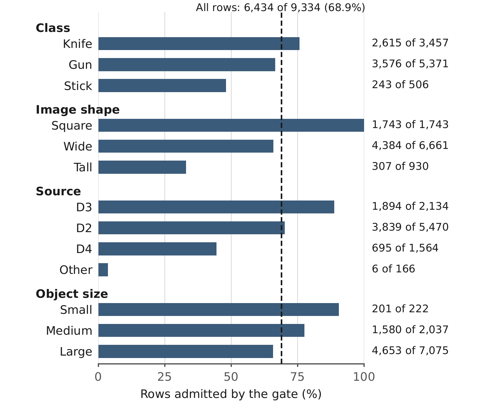

# Teacher-supervision admission audit

An audit script and the evidence files for measuring how much stored teacher supervision a geometry-consistency gate admits in detector distillation.

## What this is

In detector distillation, stored teacher outputs are re-attached to training batches. In the measured pipeline a geometry-consistency gate at IoU 0.999 admitted 6,434 of 9,334 teacher-evidence rows (68.9%), because two code paths resize images by different conventions. This repository holds the audit script, the evidence files of the measurement and of two pre-specified experiments, and the commands to recompute the reported numbers. No image, annotation, training code or checkpoint is included.

## Key numbers

All numbers in this table are copied from `evidence/scrubbed/kais_v4/audit_out/runtime_gate/runtime_gate_analysis.txt` (pass 1: line 5 and lines 8-10, 21-24, 26-28, 30-32). Pass 2 gives the same numbers (line 62 and lines 65-89 of the same file). `n` is the number of box-eligible teacher-evidence rows; `rate` is admitted / n.

| Stratum | Level | n | admitted | rejected | rate |
|---|---|---:|---:|---:|---:|
| Overall | all rows | 9334 | 6434 | 2900 | 0.6893 |
| Class | gun | 5371 | 3576 | 1795 | 0.6658 |
| Class | knife | 3457 | 2615 | 842 | 0.7564 |
| Class | stick | 506 | 243 | 263 | 0.4802 |
| Source | D2 | 5470 | 3839 | 1631 | 0.7018 |
| Source | D3 | 2134 | 1894 | 240 | 0.8875 |
| Source | D4 | 1564 | 695 | 869 | 0.4444 |
| Source | other | 166 | 6 | 160 | 0.0361 |
| Image shape | square | 1743 | 1743 | 0 | 1.0000 |
| Image shape | tall | 930 | 307 | 623 | 0.3301 |
| Image shape | wide | 6661 | 4384 | 2277 | 0.6582 |
| Object size | large>=96^2 | 7075 | 4653 | 2422 | 0.6577 |
| Object size | medium | 2037 | 1580 | 457 | 0.7757 |
| Object size | small<32^2 | 222 | 201 | 21 | 0.9054 |

The file calls the image-shape stratum "image aspect" and the object-size stratum "size bin".

## Quick start

Run from the repository root. The first command needs a POSIX shell and `sha256sum` or `shasum`. The second needs Python 3 (standard library only). The third needs numpy.

    sh scripts/verify_manifest.sh
    sh scripts/recompute_gate.sh
    python3 admission_audit/admission_audit.py --csv admission_audit/example_boxes.csv --strata image_shape

1. `verify_manifest.sh` checks the SHA-256 of every file under `evidence/` against `evidence/MANIFEST.sha256` (555 files).
2. `recompute_gate.sh` recomputes the run-time gate summary from the files in `evidence/gate_rows_nocoord/` and compares it byte for byte with the filed summary. The folder holds per-row files for the rows of the sources D3 and D4. For the other rows it holds count cells, totals and sorted value lists.
3. The third command runs the audit script on 16 synthetic box pairs. The example is an illustration, not a result of the paper.

Expected outputs are in [docs/REPRODUCE.md](docs/REPRODUCE.md).

## Run the check on your own pipeline

`admission_audit/admission_audit.py` takes two row-aligned sets of boxes for the same objects: the boxes as one code path places them (path A, for example the path that produced the stored teacher boxes) and as the other code path places them (path B, for example the data loader of the student). Boxes are `x1, y1, x2, y2` in pixels of the same canvas. A row is admitted when the IoU of its two boxes is at least `--threshold` (default 0.999).

Two input forms:

    # one CSV, columns ax1,ay1,ax2,ay2 (path A) and bx1,by1,bx2,by2 (path B);
    # any further column can be a stratum
    python3 admission_audit/admission_audit.py --csv rows.csv --strata class,source

    # two .npy arrays of shape (N, 4), row-aligned (no strata in this form)
    python3 admission_audit/admission_audit.py --npy-a a.npy --npy-b b.npy

Options: `--threshold T`, `--json FILE` (writes the same content as JSON), `--selftest` (synthetic check). The output gives the rows total and admitted, the share admitted at IoU 0.5, 0.9, 0.99 and 0.999, quantiles of IoU and of the per-edge offsets in pixels, and the counts per stratum. From Python, `audit(box_a, box_b, strata=None, threshold=0.999)` returns the same content as a dictionary.

The script does not read images and does not run a detector. You export the box pairs from your own two code paths. See [admission_audit/README.md](admission_audit/README.md) for a runnable example.

## Repository layout

    README.md            this page
    CITATION.cff         title and repository URL; to be completed on publication
    requirements.txt     what the scripts need
    admission_audit/     admission_audit.py, a synthetic example CSV, README.md with usage
    scripts/             verify_manifest.sh, recompute_gate.sh, recompute_analyses.sh, make_fig_admission.py
    assets/              fig_admission.png, the figure above
    docs/                REPRODUCE.md, DATA_NOTES.md
    evidence/            the evidence files (Online Resource 13 of the paper)
        README.md            what each file is and how each result is recomputed
        EXCLUDED.md          what is not included and what a reader loses
        MANIFEST.sha256      SHA-256 of every file under evidence/
        as_filed/            byte-for-byte copies of filed files: protocol, addenda, analysis scripts, results, predictions
        scrubbed/            copies with server paths, host names and user names replaced; SCRUB_TABLE.tsv
        tools/               scrub.py, recompute.py, recompute_map.py, admission_audit.py, make_fig_admission.py, file lists, example rules
        _test_out/           outputs of the test runs of 21 and 22 Nov 2026
        gate_rows_nocoord/   run-time gate measurement without coordinates: per-row files (D3, D4), counts and value lists (other rows), analysis script

The wrappers in `scripts/` write their outputs to `_out/` in the repository root. They do not write into `evidence/`.

## Reproducing the paper's results

`evidence/` holds the files of the run-time gate measurement and of the two pre-specified experiments (the schedule-by-seed order experiment and the mechanism experiment with its same-card control). Each row below recomputes a filed result and compares it with the filed file. Details, expected outputs and limits are in [docs/REPRODUCE.md](docs/REPRODUCE.md).

| Result | Command | Compared with |
|---|---|---|
| Integrity of all evidence files | `sh scripts/verify_manifest.sh` | `evidence/MANIFEST.sha256` |
| Run-time gate: admitted count, strata, pass comparison. For the 5,636 rows of D2 and of the pooled sources the inputs are counts, flags and totals supplied by the authors; see `evidence/gate_rows_nocoord/README.txt` | `sh scripts/recompute_gate.sh` | `evidence/scrubbed/kais_v4/audit_out/runtime_gate/runtime_gate_analysis.txt` |
| Order contrast table and mechanism contrasts Q1-Q6 | `sh scripts/recompute_analyses.sh order` | `evidence/as_filed/kais_v4/analysis/results_final_sbs_20261115T011951Z.json` |
| Image-resampling intervals of the contrasts | `sh scripts/recompute_analyses.sh a04` | `evidence/as_filed/kais_v4/analysis/a04_contrasts_20261115T012010Z.json` |
| Same-card comparison | `sh scripts/recompute_analyses.sh add06` | `evidence/as_filed/kais_v4/analysis/results_add06_20261121T045950Z.json` |
| Byte identity of the seven prediction pairs | `sh scripts/recompute_analyses.sh pairs` | field `card_pairs` of the same-card results file |
| Filed digests of the analysis and launch scripts | `sh scripts/recompute_analyses.sh digests` | `evidence/as_filed/kais_v4/ANALYSIS_ADDENDUM_06.sha256`, `ANALYSIS_CODE_RECORD_01.md` |
| Endpoint values (mAP50-95, AP50, AP75, per class) of the 46 runs from the prediction files. Needs Online Resource 10 of the paper and the two providers' annotation files; see docs/REPRODUCE.md, section 3a | `python3 evidence/tools/recompute_map.py --or10 <S8_File> --mode full` | `evidence/scrubbed/eval/factorial_v3_freeze/<run>/metrics_unified.json` |

The five rows before the last one need numpy and scipy. The last row needs numpy and pycocotools. Exact equality with the filed values depends on the library versions (see `requirements.txt` and docs/REPRODUCE.md).

## What is not here

From `evidence/EXCLUDED.md`, which gives the reason and what a reader loses for each item:

- No images.
- No annotations: the ground-truth files of the validation images and the row-level files with box coordinates or image paths are withheld. They include rows from sources whose annotations are restricted.
- No training code. The patches that define the conditions of the mechanism experiment are withheld, so the launch scripts under `evidence/as_filed/` cannot run.
- No checkpoints. Predictions cannot be regenerated. The endpoint values can be recomputed from the filed predictions only together with Online Resource 10 of the paper (last row of the table above).
- No training logs.
- No mask files and no row-key lists of the masked runs. Only the counts per pass in the admission logs remain.
- No original per-row files of the run-time gate measurement. `evidence/gate_rows_nocoord/` holds per-row files without coordinates for the 3,698 rows of the sources D3 and D4. For the other 5,636 rows it holds count cells, totals, sorted value lists and bin counts, and no per-row record.
- No evaluation directories of the best-checkpoint and internal-split sensitivity analyses. Their result files can be read but not recomputed.

See also [docs/DATA_NOTES.md](docs/DATA_NOTES.md).

## Paper

The accompanying paper is under review; the citation will be added on publication.

## License

The code and documentation of this repository are released under the MIT License (see [LICENSE](LICENSE)). Files derived from the third-party data sets remain subject to the terms of those data sets; see [docs/DATA_NOTES.md](docs/DATA_NOTES.md).
